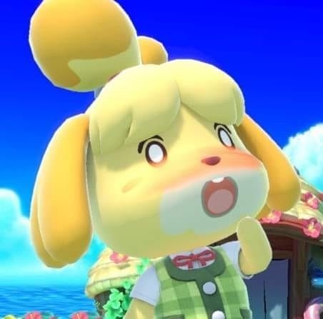

<p align="center">
  
</p>

<h1 align="center">Raccoon Mortgage Simulator</h1>

<p align="center">
  <b>Animal Crossing: New Horizons, running natively on iPhone.</b><br>
  Built on <a href="https://github.com/seedds/nxnative">nxnative</a>. Bring your own dump: no game files are included.
</p>

<p align="center">
  
  
  
  
</p>

<p align="center">
  <a href="#features">Features</a> ·
  <a href="#what-you-need">What you need</a> ·
  <a href="#build-it">Build it</a> ·
  <a href="#settings">Settings</a> ·
  <a href="#mods">Mods</a> ·
  <a href="#credits">Credits</a>
</p>

---

It is not an emulator: the game's own code runs on the iPhone's chip, and its graphics are rebuilt on Metal. Everything game-specific lives in the game profile, [`dm/games/01006F8002326000`](dm/games/01006F8002326000/README.md).

> [!NOTE]
> Tested on an iPhone 18 Pro, sideloaded with LiveContainer. Older iPhones (A14 to A16) are supported by the texture conversion below but have not been tested.

## Features

| | |
|---|---|
| 🌿 **Island touch controls** | Transparent controls with a fat cat stick that squishes against its ring, a leaf D-pad, a stick you can grab anywhere below it, and a hidden right stick on the right half of the screen. A touch key at the top right hands the screen to the game. |
| 🏪 **Nook's Cranny launcher** | A themed start screen with quick tiles for frame rate, frame generation and ultrawide, every other setting in a panel, and cloud saves. |
| 🎞️ **30 or 60 fps** | 60 fps through the SpeedFix code mod, which keeps the island's clock, walking and animations at normal speed. 30 fps is the original game. |
| ✨ **Frame generation** | MetalFX frame interpolation shows a generated frame between each two the game draws: 60 a second at 30 fps, 120 at 60 fps on a 120 Hz screen. |
| ↔️ **Ultrawide** | A code mod widens the 3D view to the iPhone's 19.5:9 screen, and the picture is stretched to fill it. |
| 🧩 **Mod manager** | Import romfs mods (a .zip or a folder) in the app's Mods tab, turn each on or off, and order them; the top one wins. |
| 🖼️ **Textures for older iPhones** | The game's BC textures are re-encoded to ASTC, EAC and ETC2 ahead of time, so GPUs without BC formats can draw them with no work at run time. |
| 🪶 **Low memory** | The game's memory pool lives in files iOS can page out (`DM_GUEST_FILE`), so the app stays well under iOS's limit. |
| 🎁 **DLC** | Add-on content such as Happy Home Paradise is converted and packed with the game. |

## What you need

- Your own dump of **Animal Crossing: New Horizons 3.0.3**: the base game NSP, the 3.0.3 update NSP and any DLC NSPs, in one folder.
- Your own `prod.keys` (and `title.keys` if your dump needs them), next to the NSPs.
- A Mac with Xcode to build, and a way to sideload an unsigned IPA (tested with LiveContainer).
- About **13 GB free** on the iPhone for the game files.

Game files, keys and anything extracted from them stay in your NSP folder. Nothing from the game is in this repository.

## Build it

The commands run from this repository's folder with nxnative's Python environment (see [Requirements](#requirements) below), where `GAME` is your NSP folder.

**1. Extract the game** (the first run of the build script does it):

```bash
python scripts/build_ipa_from_nsp.py "$GAME" -k "$GAME/prod.keys" --romfs separate
```

**2. Convert the textures for iPhone.** This makes a new game image whose BC textures are ASTC / EAC / ETC2, checked against the original (lowest PSNR 40 dB):

```bash
python scripts/bntx_astc.py "<the extracted RomFS.img>" "<RomFS.recode.img>" --eac --floor-psnr 40 --report "$GAME/recode_report.tsv"
```

Convert each DLC image the same way, put the results in `<title ID>_build/aoc.converted/`, and merge their tables into the game image with `--merge-tables`. Then put the converted image in place of the extracted `RomFS.img`.

**3. Add the code mods** (optional): copy the folders of [`dm/games/01006F8002326000/mods`](dm/games/01006F8002326000/mods/README.md) into a `mods` folder next to your NSPs, and download the 60 fps mod as its README says.

**4. Build the IPA** with an env file holding these three lines:

```text
DM_GUEST_FILE=1
DM_BC_RECODE=1
DM_BC_OPTIONAL=1
```

```bash
python scripts/build_ipa_from_nsp.py "$GAME" -k "$GAME/prod.keys" --env-file acnh_env.txt --romfs separate
```

Set `DM_LAUNCHER_BG` to a picture of your own to give the launcher a background.

**5. Install and copy the game files.** Sideload the IPA, open it once, then copy the game image to the phone with the command the build prints (`scripts/push_romfs.sh`).

## Settings

| Setting | Values | Notes |
|---|---|---|
| Frame rate | 30, 60 | 60 turns on the SpeedFix code mod and its data files |
| Frame Generation | on, off | Doubles the frames shown; on a 120 Hz screen at 60 fps the display runs at 120 Hz |
| Ultrawide | on, off | Widens the 3D view; menus, the HUD and loading screens stay 16:9, stretched |
| Picture | Fit, Fill | Fill crops the 16:9 picture to cover the screen (ignored while Ultrawide is on) |
| Performance HUD | on, off | Frame rate, GPU time, memory and temperature at the top of the screen |

Frame rate and Ultrawide take effect when you press Play.

## Mods

- **Romfs mods** (replaced game files, `<name>/romfs/...`) are added on the phone in the launcher's Mods tab. They load when you press Play, over the game's files.
- **Code (ExeFS) mods** can't be added on the phone: iOS does not let an app change its own code. They are built into the app ([`dm/tools/exefs_mods.py`](dm/tools/exefs_mods.py)), and a mod with a `dm_toggle.txt` gets a switch: the build embeds a copy of each module it patches for every combination of mods, and the app maps the one your settings call for. See [`dm/games/01006F8002326000/mods`](dm/games/01006F8002326000/mods/README.md).

## Credits

This port stands on a lot of other people's work. Thank you to all of them.

**Code**

| Who | What |
|---|---|
| [seedds/nxnative](https://github.com/seedds/nxnative) (MIT) | Everything this port is built on: the NSO rewriter, the Horizon host, NVN on Metal, the iOS app, the build scripts, and the original Animal Crossing profile. Its own acknowledgements are [below](#acknowledgements). |
| [cheemu21/kid-with-sword-remake](https://github.com/cheemu21/kid-with-sword-remake) (MIT) | Frame generation (MetalFX interpolation on the display link, the motion search `fgmv.metal`, its unit test) and the romfs mod manager (`mods.h`, `mods_zip.h`, `hle_mods.c`, `Mods.swift`) |
| [jhaizhou-ops/d2r-mobile](https://github.com/jhaizhou-ops/d2r-mobile) (MIT) | The native-execution approach nxnative grew from |
| [texture2ddecoder](https://github.com/K0lb3/texture2ddecoder) by K0lb3 (MIT) | The BC7 partition and anchor tables in the GPU BC decoder (`bcdec.metal`), and texture decoding in the converter |
| [astc-encoder-py](https://github.com/K0lb3/astc-encoder-py) by K0lb3 (MIT), wrapping Arm's [ASTC Encoder](https://github.com/ARM-software/astc-encoder) (Apache 2.0) | ASTC encoding in `scripts/bntx_astc.py` |
| [etcpak](https://github.com/K0lb3/etcpak) by K0lb3 (MIT), wrapping [etcpak](https://github.com/wolfpld/etcpak) by Bartosz Taudul (BSD 3-Clause) | ETC2 and EAC encoding in `scripts/bntx_astc.py` |
| [NumPy](https://numpy.org) (BSD 3-Clause), [backports.zstd](https://pypi.org/project/backports.zstd/) | The converter's array work and zstd |
| [Atmosphère](https://github.com/Atmosphere-NX/Atmosphere) | The reference for how a Switch loads IPS code patches (`ldr_patcher`), which the code mod build follows |
| IPSwitch and [Eden](https://git.eden-emu.dev/eden-emu/eden) | The `.pchtxt` patch format, and how emulators load code placed after a module's text |
| Apple | Metal, MetalFX, SF Symbols |

**Mods**

| Mod | Author | License |
|---|---|---|
| [ACNH 60 FPS + SpeedFix (3.0.X)](https://gamebanana.com/mods/722295) v1.4.5 | **tmouh** | CC BY-NC 4.0. Not redistributed here; this repository has only its switch file. |
| ACNH 3.0.3 21:9 Ultrawide v2 | not named in its files | MIT No Attribution. Included with its target ratio changed from 43:18 to 19.5:9 for iPhone screens. |
| [Aspect Ratio Patches (4:3/16:10/21:9/32:9)](https://gamebanana.com/mods/449287), the earlier ACNH aspect-ratio work the ultrawide mod builds on | **theboy181** (original creator), **victoria4dx** (2.0.5 version), **Hyper** (updater), with **OldManKain** (development help) | MIT No Attribution |

**And**

- **Nintendo** made Animal Crossing: New Horizons. This project is not affiliated with or endorsed by Nintendo. Please buy the game and dump your own copy.
- [LiveContainer](https://github.com/LiveContainer/LiveContainer), which the port was tested in.

---

The rest of this page is nxnative's.

# About nxnative

Play your own Nintendo Switch and Switch 2 games natively on Apple silicon Macs, iPhone and iPad. One script packs your game into a Mac app or an unsigned IPA that you sideload.

It is not an emulator: the game's own code runs directly on the Apple chip, with Switch graphics rebuilt on Metal. Nothing from any game is in this repository, and the project is not affiliated with Nintendo or any game publisher.

[Games](#games) · [Community front ends](#community-front-ends) · [Requirements](#requirements) · [How to play](#how-to-play) · [Discussions](#discussions) · [For developers](#for-developers)

## Games

The full [tested games table](dm/games/README.md#games) includes original Switch games, tested builds, engines and graphics APIs. Each game's note records its tested platforms, progress and known issues.

These Switch 2 games have passed Mac gameplay testing. Build them from a [`.nup` file or a dump folder](#switch-2-games):

- [Donkey Kong Bananza](dm/games/040074A01BF12000/README.md)
- [Fast Fusion](dm/games/040041E0212AE000/README.md)
- [Fire Emblem Fortune's Weave](dm/games/04007EF01F8AE000/README.md) — up to 120 fps
- [Hyrule Warriors: Age of Imprisonment](dm/games/04003F40232DE000/README.md)
- [Kirby Air Riders](dm/games/040077201BE50000/README.md)
- [Mario Kart World](dm/games/0400C3F00006E000/README.md)
- [Mario Tennis Fever](dm/games/0400D4201C6EA000/README.md)
- [Nintendo Switch 2 Welcome Tour](dm/games/040057C02159A000/README.md) — Area A tested; exhibits need further testing
- [Nintendo Switch Sports Resort](dm/games/04008E001F098000/README.md)
- [Orbitals](dm/games/040032B023CA4000/README.md) — two players: a controller for player 2
- [Pokémon Pokopia](dm/games/0400A3A01EE4C000/README.md)
- [PRAGMATA](dm/games/0400C76024710000/README.md)
- [Splatoon Raiders](dm/games/0400380020056000/README.md)
- [Star Fox](dm/games/0400E88025B1A000/README.md)
- [Super Mario Bros. Wonder – Nintendo Switch 2 Edition + Meetup in Bellabel Park](dm/games/040015100B514001/README.md)
- [The Legend of Zelda: Ocarina of Time](dm/games/0400486024DEC000/README.md)
- [Yoshi and the Mysterious Book](dm/games/0400245021D2C000/README.md)

## Community front ends

Community projects build on nxnative with tools to turn your games into apps for your iPhone, iPad or Mac without the command line, and libraries to organize and launch them. They are separate projects: questions and bugs about them go to their own pages.

- [NX2Apple](https://github.com/LNPANDY/NX2Apple) — Mac builder with a shared iPhone/iPad game library.
- [NX Play](https://github.com/varyform/nx-native-wrapper) — Mac library with device installs and save sync.
- [NxNative Launcher](https://github.com/rennan101us/nxnative_Launcher) — Mac launcher with guided builds and controller mapping.
- [nxnative Easy](https://github.com/nalancer08/nxnative-easy) — Mac game library with guided builds, iPhone and iPad installation and signature renewal, and iCloud save sync.
- [LumaNX](https://github.com/Xc1Ym/LumaNX) — Mac game builder with IPA export.
- [GameCase](https://github.com/Tiaoge-tou/GameCase) — iOS game library based on LiveContainer.

## Requirements

- **Mac:** Apple silicon, macOS 26.6 or later. Building games requires Xcode 27.2.
- **iPhone:** A17 Pro chip or later, with iOS 26 or later.
- **iPad:** M1 chip or later, with iPadOS 26 or later.

The games' textures are BC-compressed, which older iPhones cannot read. Switch 2 builds are tested on the Mac; check each game's note for device-specific validation.

For a game without a profile, the script writes a survey and tries a provisional build with guessed settings. That build may not start; see [Port another game](docs/development.md#port-another-game).

## How to play

For a Switch 2 game, follow the [Switch 2 build instructions](#switch-2-games) with a `.nup` file or a dump folder.

### Build from the command line

You need a Mac with macOS 26.6 or later, [Xcode](https://developer.apple.com/download/all/?q=Xcode%2027.2) 27.2, [Homebrew](https://brew.sh) and an arm64 build of Python 3.12 or newer. To build an IPA, install Xcode's iOS platform (Xcode → Settings → Components).

The shaders are built with Xcode 27.2's Metal compiler. Select it before step 1: `sudo xcode-select -s /Applications/Xcode.app`. With several Xcode versions installed, name this one `Xcode-27.2.app` and select it with `sudo xcode-select -s /Applications/Xcode-27.2.app`.

**1. Install the tools** (only once), in Terminal:

```
xcodebuild -downloadComponent MetalToolchain
git clone https://github.com/seedds/nxnative.git && cd nxnative
brew install xcodegen zstd glslang
python3 -m pip install lz4 "capstone>=5,<6" fonttools nsz zbic "backports.zstd; python_version < '3.14'"
```

**2. Put your Switch 1 game in a folder.** Include any updates and DLC you want to pack. The script reads `.nsp`, `.xci`, `.nsz` and `.xcz` files.

```
~/Games/MarioWonder/
  Super Mario Bros. Wonder [010015100B514000][v0].nsp
  Super Mario Bros. Wonder [010015100B514800][v327680].nsp
```

**3. Build**, with your game folder and your `prod.keys`:

```
python3 scripts/build_ipa_from_nsp.py ~/Games/MarioWonder -k ~/keys/prod.keys
```

For a Mac app, add `--platform mac-app` and open the resulting `.app` in Finder. By default, the script saves the IPA or Mac app in the game's folder. See [The packing script in detail](docs/development.md#the-packing-script-in-detail) for all options.

The first build takes 30–60 minutes and needs about twice the game's size plus 10 GB of free disk space. Rebuilding is much faster.

### Install

Install the IPA on your iPhone or iPad with a sideloading tool such as AltStore, Sideloadly or LiveContainer. If your tool offers **Increased Memory Limit**, turn it on: the bigger games need it.

Game too big to install? Build again with `--romfs separate`, and run the command the script prints once to copy the game files to your phone ([Quick reinstalls](docs/development.md#quick-reinstalls)). With AltServer, also add `--shader-files`: it cannot install a file of 2 GiB or more.

If a sideloading tool fails to extract a large IPA, try `--prepare-xcode` and [install from Xcode](docs/development.md#build-and-run-on-a-device-with-xcode).

Controls, saves and settings: [Playing](docs/playing.md).

### Switch 2 games

Build a Switch 2 game from one [NUP](https://github.com/a55uka/nup) container (a `.nup` file) or a dump folder. Both inputs work without `prod.keys`. If the game has no profile in this project, the script surveys it and creates a provisional profile. The resulting build may fail to boot. See [Port another game](docs/development.md#port-another-game).

**From a `.nup` file**, which holds the base game, its updates and DLC in one file. Give the file, or a folder that holds it:

```
python3 scripts/build_ipa_from_nsp.py ~/Games/DonkeyKongBananza.nup --platform mac-app
```

[Hyrule Warriors: Age of Imprisonment](dm/games/04003F40232DE000/README.md) is played this way: its 47 GB NUP unpacks in under five minutes. A NUP that carries the game's control data (its NACP) and icon gives the app the game's name and icon; otherwise the name comes from the game's profile and the app has no icon unless you give it one with `--icon <image>` (`ICON` in Spyder; a JPEG or PNG of any size). The script also reads [NUPs with shifted metadata numbers](docs/reference/packing.md#a-nup-icon-is-written-as-control-data).

A Nintendo Switch 2 Edition of a Switch 1 game can hold both of its programs in one NUP: the Switch 1 program with the game data, and the Switch 2 program, which reads that data from the Switch 1 program and its Switch 2 files from the upgrade add-on. The script packs the Switch 2 program, with the Switch 1 program's game files beside its own and the add-on as DLC; `--program 0` packs the Switch 1 program instead.

A NUP without the base game can have an empty base record or omit the base record entirely. With no base record, every update must be marked `standalone_update`. In either case, the script reports that it is using the selected update as the whole game. That update needs a complete ExeFS and RomFS. If files are missing, pack a NUP with the base game. The script selects the newest update by default. Use `--package v<N>` to select another update. `v0` requires a base game.

**From a folder of files**. The script expects this layout (`updates` and `dlc` are optional):

```
~/Games/DonkeyKongBananza/
  base/exefs/                     main, main.npdm, sdk, rtld
  base/romfs/
  updates/458752/exefs/           the update's version, as a decimal number
  updates/458752/romfs/           the patched RomFS, not a patch
  dlc/040074a01bf13001/0/romfs/   the DLC's title ID
```

```
python3 scripts/build_ipa_from_nsp.py ~/Games/DonkeyKongBananza --platform mac-app
```

You can also pass a complete update folder directly, for example `~/Games/DonkeyKongBananza/updates/458752`. The script treats a folder with `exefs/` and `romfs/` at its root as `base/`, including folders made by `nup extract`. Use `--icon <image>` (`ICON` in Spyder) to supply an icon for the app. To turn a dump folder into a NUP, run `nup pack ~/Games/DonkeyKongBananza game.nup`. See [The packing script in detail](docs/development.md#the-packing-script-in-detail) for more options.

## Discussions

Use [Discussions](https://github.com/seedds/nxnative/discussions) for questions, ideas and reports on how games run on your Mac or iPhone. File bug reports in [Issues](https://github.com/seedds/nxnative/issues) and include the log. Follow frame rate, resolution and which Macs hold 60 fps in [Ocarina of Time: state on main](https://github.com/seedds/nxnative/discussions/1789).

## For developers

[How it works](docs/development.md) · [Game notes](dm/games/README.md#games) · [Bring-up and debugging](docs/agents/README.md) · [Front ends](docs/frontends.md) · [Contributing](CONTRIBUTING.md)

## Acknowledgements

This project is built on other people's work ([licenses](dm/third_party/README.md)):

- **[d2r-mobile](https://github.com/jhaizhou-ops/d2r-mobile)** (MIT) developed this native-execution approach, for Diablo II: Resurrected. nxnative started as a copy of its generic parts: the NSO rewriter, the host that stands in for Horizon, the NVN-on-Metal layer and the iOS app shell. Fixes go both ways.
- **Ryujinx** (MIT): its shader translator (`Ryujinx.Graphics.Shader`, `Ryujinx.Common` and `Spv.Generator` 1.3.2, in `dm/third_party/ryujinx` with a few fixes listed in [its README](dm/third_party/ryujinx/README.md)) turns the games' shaders into SPIR-V. Its emulation of the kernel and system services is also a reference when the host's behaviour is in doubt.
- **[Atmosphère](https://github.com/Atmosphere-NX/Atmosphere)**: its kernel, mesosphère, is the reference for Horizon's synchronization semantics (address arbiter, condition variables).
- **[LibHac](https://github.com/Thealexbarney/LibHac)**: reads NSPs and layers updates over the base game in `dm/tools/nx_extract`.
- **[SPIRV-Cross](https://github.com/KhronosGroup/SPIRV-Cross)**: SPIR-V to Metal Shading Language.
- **[glslang](https://github.com/KhronosGroup/glslang)** compiles the GLSL of OpenGL games to SPIR-V for it.
- **[MacNativeGames](https://github.com/ly05010419/MacNativeGames)** (MIT): the GPU widening of 8-bit indices and in-pass clears in `dm/gfx/nvn/nvn_mtl.m`, and the visibility-counter lowering in the shader translator.

## License

MIT ([LICENSE](LICENSE)). Third-party code keeps its own license ([dm/third_party](dm/third_party/README.md)).
